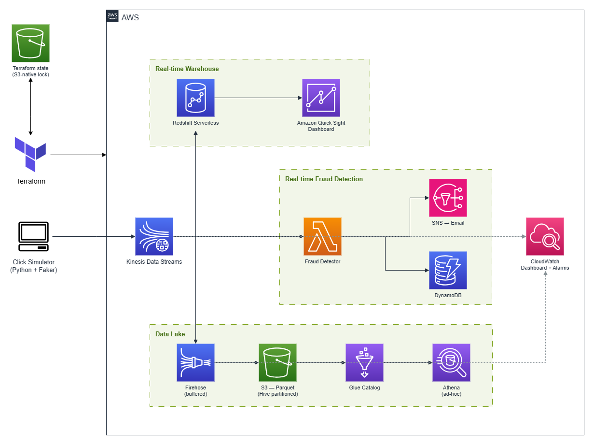
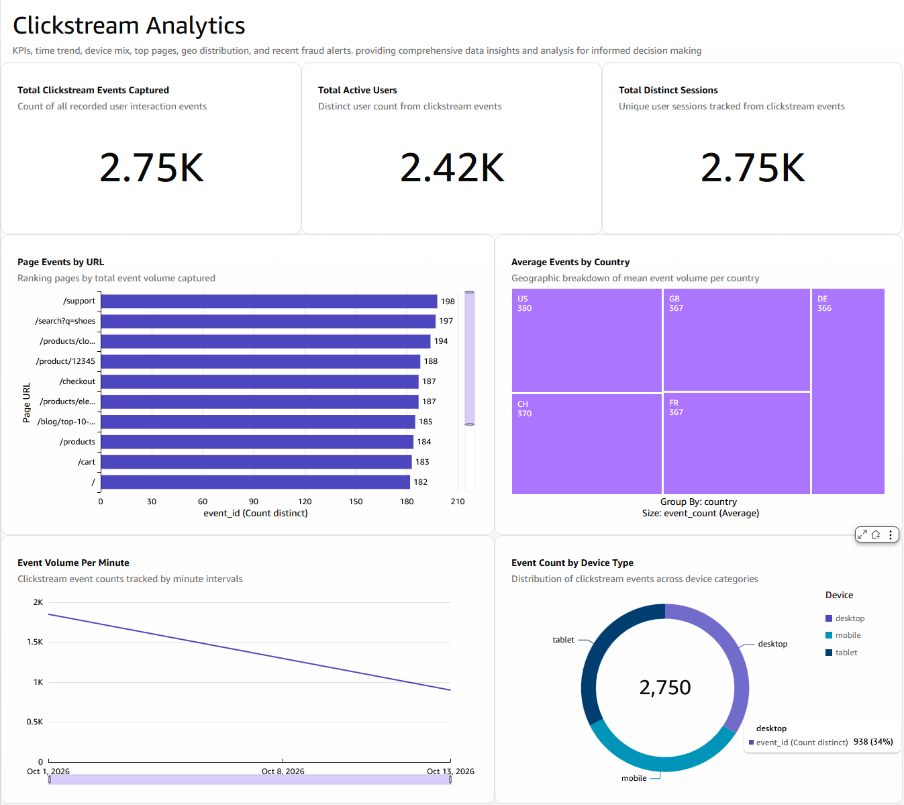

# Clickstream Analytics - Data Engineering Project

A real-time clickstream analytics **lakehouse** on AWS, built end-to-end with **Terraform**.
Click events are ingested through **Kinesis Data Streams** and fan out to three
independent consumers:

- **Real-time warehouse** — **Redshift Serverless Streaming Ingestion** pulls events
  straight off the stream (sub-second), powering an **Amazon Quick Sight** dashboard.
- **Data lake** — **Kinesis Firehose** lands events as date-partitioned **Parquet** in
  **S3**, catalogued in **Glue** and queried ad-hoc with **Athena**.
- **Real-time fraud detection** — a **Lambda** maintains a per-user sliding window in
  **DynamoDB** and fires a single **SNS** email alert per fraud episode.

A **CloudWatch** dashboard and alarms monitor the pipeline end-to-end.

## Architecture

<p align="center">
  
</p>

## Project layout

```
terraform/              root composition + modules
  modules/
    network/            VPC, subnets, security groups
    storage/            S3 buckets (raw Parquet lake, access)
    kinesis/            Kinesis Data Stream + Firehose (S3 Parquet delivery)
    redshift/           Redshift Serverless + streaming-ingestion IAM role
    glue_catalog/       Glue database/table + Athena workgroup
    fraud_detection/    fraud Lambda + DynamoDB + SNS topic
    quicksight/         VPC connection, SG, execution role (BI → private Redshift)
    monitoring/         CloudWatch dashboard + alarms
lambda/
  fraud-detector/       per-user sliding-window detector (Python 3.12)
  firehose-transform/   record formatting for S3 delivery
simulator/              Faker-based Kinesis event generator
sql/                    Redshift DDL — external schema, streaming MV, analytical MVs
```

## Main components

- **Kinesis Data Stream** — single ingestion point; on-demand capacity, partitioned by `user_id`.
- **Redshift Serverless** — an external `kinesis_schema` + an auto-refreshing streaming
  materialized view (`mv_clickstream_raw`) as the live landing zone, with analytical MVs
  (per-minute, by-device, by-country, top-pages) aggregated on top for the dashboard.
- **Firehose → S3 → Glue → Athena** — the data-lake arm: Parquet objects under
  `year=/month=/day=/hour=` Hive partitions, catalogued in Glue with partition projection
  so Athena queries scan only the relevant partitions.
- **Fraud detector Lambda** — counts each user's clicks in a DynamoDB item with a rolling
  TTL window; crossing the threshold publishes **one** SNS email per episode (debounced via
  a conditional write), not one per click.
- **CloudWatch** — operational dashboard and alarms over Kinesis, Firehose, and the Lambda.
- **Amazon Quick Sight** — connects to private Redshift through a Terraform-managed **VPC connection**, and dashboard to visualize the data from Redshift:

<p align="center">
  
</p>

## Deploy

Prerequisites: AWS CLI with a configured profile, Terraform ≥ 1.11, Python 3.12.

```bash
# 1. Configure inputs (never committed)
cp terraform/terraform.tfvars.example terraform/terraform.tfvars
#    set alert_email (+ region/profile if different)

# 2. Deploy the infrastructure
make deploy                 # terraform init && apply

# 3. Confirm the SNS subscription (click the link in the alert_email inbox)

# 4. Create the Redshift schema — once the workgroup is AVAILABLE
#    Redshift Query Editor v2 → database `clickstream` → run sql/redshift-schema.sql
#    (replace the <STREAMING_ROLE_ARN> placeholder with:
#     terraform -chdir=terraform output -raw redshift_streaming_role_arn)
#    Then: REFRESH MATERIALIZED VIEW clickstream.mv_clickstream_raw;
```

## Test

```bash
# Generate events
cd simulator
python3 -m venv .venv && source .venv/bin/activate
pip install -r requirements.txt
python simulator.py --duration 120 --rate 5    # ~600 normal events

# Trigger a fraud episode (separate run — one user hammering the stream)
python simulator.py --duration 60 --rate 10 --fraud
```

Verify each path:

- **Real-time warehouse** — in Query Editor v2:
  `SELECT COUNT(*) FROM clickstream.mv_clickstream_raw;` (appears within seconds).
- **Data lake** — in Athena (workgroup `clickstream-workgroup`), query with a partition
  filter: `SELECT * FROM clickstream.events WHERE year='2026' AND month='10' LIMIT 10;`
  (always include partition predicates — an unfiltered `COUNT(*)` scans the whole
  projection range and is slow).
- **Fraud detection** — you receive a single SNS email for the fraud run; the
  `FraudAlertsTriggered` metric increments on the CloudWatch dashboard
  (`terraform -chdir=terraform output -raw dashboard_url`).
- **Dashboard** — the Quick Sight dashboard reflects fresh data on reload.

## Cleanup

```bash
make destroy                # terraform destroy — removes everything
```

S3 buckets use `force_destroy = true` and DynamoDB/Redshift have no deletion
protection, so teardown is clean. The Quick Sight datasets/analysis/dashboard are
built in the console and are removed there.

## Remote state (S3 backend)

State defaults to local. To move it to S3 — durable, versioned, locked — the project
uses Terraform's **partial backend configuration** so the bucket name and account id
stay out of the repo. Locking uses **S3-native conditional writes** (`use_lockfile`,
Terraform ≥ 1.11); no DynamoDB lock table is needed.

| File | Committed? | Contents |
|---|---|---|
| `terraform/backend.tf` | ✅ | backend block **without** the bucket name |
| `terraform/backend.hcl` | ❌ gitignored | your real bucket name |
| `terraform/backend.hcl.example` | ✅ | placeholder template |

```bash
# 1. Create the state bucket (versioned, encrypted, public access blocked)
ACCOUNT_ID=$(aws sts get-caller-identity --query Account --output text)
BUCKET="clickstream-tfstate-${ACCOUNT_ID}"; REGION="eu-central-1"
aws s3api create-bucket --bucket "$BUCKET" --region "$REGION" \
  --create-bucket-configuration LocationConstraint="$REGION"
aws s3api put-bucket-versioning --bucket "$BUCKET" --versioning-configuration Status=Enabled
aws s3api put-bucket-encryption --bucket "$BUCKET" \
  --server-side-encryption-configuration '{"Rules":[{"ApplyServerSideEncryptionByDefault":{"SSEAlgorithm":"AES256"}}]}'
aws s3api put-public-access-block --bucket "$BUCKET" \
  --public-access-block-configuration BlockPublicAcls=true,IgnorePublicAcls=true,BlockPublicPolicy=true,RestrictPublicBuckets=true

# 2. Point Terraform at it and migrate
cd terraform
cp backend.hcl.example backend.hcl        # set bucket = "clickstream-tfstate-<account-id>"
terraform init -backend-config=backend.hcl -migrate-state
terraform plan                            # must report "No changes."
```

Teardown order with remote state: `terraform destroy` first, then delete the backend
bucket last (`aws s3 rb s3://<bucket> --force`) — the bucket can't be removed while it
holds the state in use.
